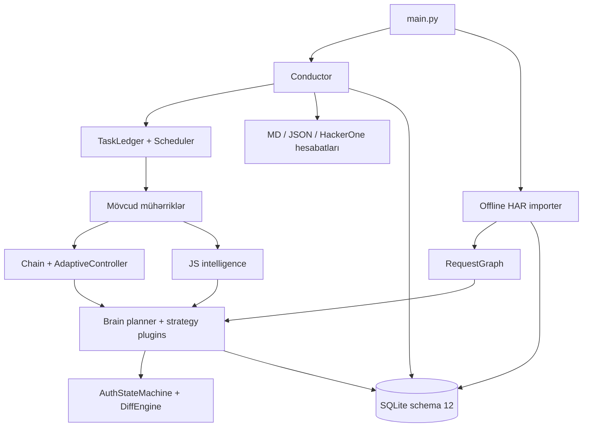

<!-- coderabbit-ai-generated:v1 -->

<!-- coderabbit-ai-generated-section:v1:5c91badf0e9ae22400abefa6e12445ff560bcc66fe14915a35d698c2053874c4 -->

# XEzer arxitekturası — Fazalar 0–8

## Axın və sahiblik

`Context` konfiqurasiya, Authorization, Guardian, vault və paylaşılan HTTP
sessiyasının sahibidir. Conductor sonunda `Context.aclose()` çağırır.
Scheduler faktiki icranı, TaskLedger planlaşdırma və dedup qərarlarını sayır.
Plan sayı icra edilmiş test sayı kimi göstərilmir.

## İcazə sərhədləri

`authorization.py` yeganə scope/RoE qərar mərkəzidir. `HttpPolicy` native
sorğuları və redirect-ləri bu qərardan keçirir. Conductor/Chain əməliyyat adı
ContextVar ilə hər native sorğuya daşınır; paralel task-lar bir-birinə qarışmır.
`egress.py` subprocess başlamazdan əvvəl alət icazəsini, məlum target-ləri və
DNS həllini yoxlayır. Bu yoxlama external binary-nin sonradan yaratdığı hər
HTTPS path/method sorğusunu intercept etmir. Ona görə bütün trafik üçün
path/method/429 zəmanəti yoxdur; release gate açıqdır.

## Faza xəritəsi

| Faza | Əsas modullar | Müqavilə |
|---|---|---|
| 0–2 | urlintel, tasks, scheduler, cache, recovery, db | URL identity, 4 vəziyyət, bounded execution, durable resume |
| 3 | ingest/har_importer, ingest/request_graph | Offline idxal, şifrəli occurrence-lər, izah olunan inferred edges |
| 4 | brain/classifier, context, planner, strategy, knowledge | 12 kateqoriya, 15 data-only sinif, IDOR/JWT plugins |
| 5 | brain/diff_engine | Fərqlər və alternativ izahlar; avtomatik vulnerability qərarı yoxdur |
| 6 | brain/auth_state, auth_config, resource_policy | ENV/vault credential, ayrıca sessiyalar, ownership əsasında IDOR |
| 7 | adaptive, chain, brain/store, recovery | Prerequisite hash, bounded reconsideration, durable audit |
| 8 | engines/jsanalysis, brain/js_intelligence | AST + mövcud fallback, source maps, HAR əlaqələri |

Phase 9 yoxdur; LLM tələb edilmir. Yeni strategy modulunun discovery-si mərkəzi
orchestrator-u dəyişməyi tələb etmir. Bilik bazasında kod icra edilmir. İki yeni
plugin bütün 15 sinif üçün yeni executor demək deyil: çatışmayan plugin-lər
reason ilə deferred saxlanır, əvvəlki mühərriklər ayrıca işləyir.

## Bir verilənlər bazası

`qbh/db.py`, **SCHEMA_VERSION=12**. Migrations mövcud cədvəlləri saxlayır.

| Sahə | Cədvəllər |
|---|---|
| Mövcud skan/sübut | scans, hosts, urls, findings, evidence, stage_status, secrets |
| Davamlılıq | task_state, event_state, followup_queue |
| HAR | imported_requests, import_entries, request_graph_edges |
| Brain | test_plans, test_plan_events, test_plan_results, plan_reconsiderations |
| Auth / JS | auth_sessions, js_observations |

FK və indekslər scan/plan əlaqələrini qoruyur. Şifrəli nəticə tarixçəsi əvvəlki
nəticəni itirmir. Rədd edilmiş plana gec gələn nəticə tarixçədə qalır, rədd qərarı
ləğv olunmur. Vault açarı DB-dən ayrı saxlanmalıdır; ciphertext report üçün
raw sübut əvəzi deyil. CLI yalnız maskalanmış metadata göstərir.

## Təsdiq və məhdudiyyətlər

IDOR təsdiqi JSON owner-only siyasətinə əsaslanır; bilinməyən ownership,
public resurs, eyni subject, rol uyğunsuzluğu, expiry və ambiguous policy
confirmation yaratmır. DiffEngine timing üçün təkrar müqayisə edilə bilən
ölçmələr tələb edir. JWT tool mətni server acceptance sübutu deyil.

Esprima 4.0.1 ECMAScript 2017 parsing istifadə edir; yeni sintaksis və dinamik
ifadələrdə fallback/limitation qeyd olunur. JS permission işarəsi backend
zəifliyi deyil. Source map büdcəsi: 5 map/JS, 20 embedded source/map; qalanlar
səbəblə saxlanır. Xarici service reference-lər avtomatik test edilmir.

Cari test sayları, coverage, benchmark və CI nəticələri
[FINAL_REPORT](FINAL_REPORT.md)-da saxlanır. Tarixi PHASE0–8 hesabatları həmin
mərhələlərin nəticələridir; release hazırlığı üçün son hesabat əsasdır.

<!-- /coderabbit-ai-generated:v1 -->